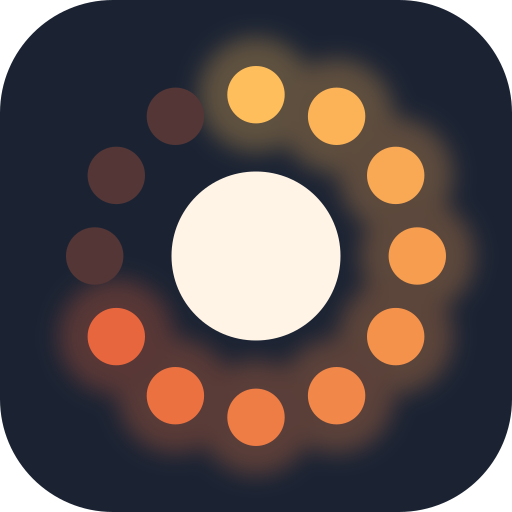

# Lauschbox

Kinder-Audiobox auf Raspberry-Pi-Basis: NFC-Token auflegen → Hörspiel/Musik von Spotify oder von der SD-Karte startet.
Konfiguration über eine eigene App (Expo, iOS + Android). Die Box spielt komplett ohne App, lokale Inhalte auch ohne WLAN.

## Struktur

| Ordner      | Inhalt |
|-------------|--------|
| `box/`      | Software auf dem Pi: box-daemon `box/lauschbox/` (Python, `python -m lauschbox`) + Hardware-Testskripte (`box/spikes/`) |
| `testapp/`  | **Die App** (Expo): echte Box, Demo-Box und Hardware-Test; läuft per Expo Go auf dem Handy ([testapp/README.md](testapp/README.md)) |
| `brand/`    | Logo (SVG/PNG) und Skript, das daraus alle App-Icons erzeugt |
| `hardware/` | Teileliste, Pinbelegung, später Schaltplan und Gehäuse (STL) |
| `docs/`     | Konzept, API-Entwurf, Setup-Anleitungen |

## Entscheidungen

- **Hardware:** Raspberry Pi Zero W (32-bit; Zero 2 W ist kompatibel), I2S-Verstärker, PN532 (I2C), WS2812-LED-Ring, 3 Taster, PiSugar-3-Akku (USB-C, Ladestand per I2C).
- **Quellen:** Spotify (Wiedergabe über go-librespot und dessen lokale API, Suche über die Spotify Web API) und lokale Audiodateien auf der SD-Karte (Wiedergabe über mpv, funktioniert offline). Audible vorerst nicht.
- **Offline:** Lokale Medien, Kindermodus und Akku funktionieren ohne WLAN; Uhrzeit kommt aus der RTC des PiSugar. Spotify braucht immer Internet.
- **Token:** Zuordnung UID → Medium liegt auf der Box, nicht auf dem Tag.
- **App:** Expo/React Native (`testapp/`), läuft ohne eigene Build-Umgebung per Expo Go. Verbindung per IP (die Box kündigt sich per mDNS an, die Suche in der App folgt), WLAN-Ersteinrichtung per Bluetooth LE geplant.

Details: [docs/konzept.md](docs/konzept.md), Hardware: [hardware/teileliste.md](hardware/teileliste.md).
Testaufbau mit dem Pi 3B+, bis der Zero da ist: [hardware/testaufbau-pi3b.md](hardware/testaufbau-pi3b.md).

## Phasen

1. **Spike Spotify** – go-librespot auf dem Pi, Wiedergabe über die lokale API starten → [docs/pi-setup.md](docs/pi-setup.md), `box/spikes/golibrespot_spike.py`
2. **Hardware-Prototyp** – NFC, Taster, LEDs, Akku einzeln testen (`box/spikes/*_test.py`)
3. **box-daemon** ✓ – Token → Wiedergabe, Taster, Lautstärke, Fortschritt, LED-Zustände, Kindermodus (`box/lauschbox/`, Tests in `box/tests/`)
4. **API + App** – ✓ Verbinden, Token anlernen per Spotify-Link, Wiedergabe, Kindermodus; offen: Spotify-Suche, Einstellungen, Akkuanzeige
5. **Lokale Medien & Offline** – Spike mpv auf dem Zero W (CPU, ALSA-Teilung mit go-librespot), LocalPlayer, Upload aus der App, Booten ohne Netz, RTC-Uhrzeit; optional Hotspot-Modus
6. **Robustheit** – Autostart, sauberes Herunterfahren bei leerem Akku, WLAN-Setup per BLE, Updates
7. **Gehäuse & Token** (3D-Druck), parallel möglich
